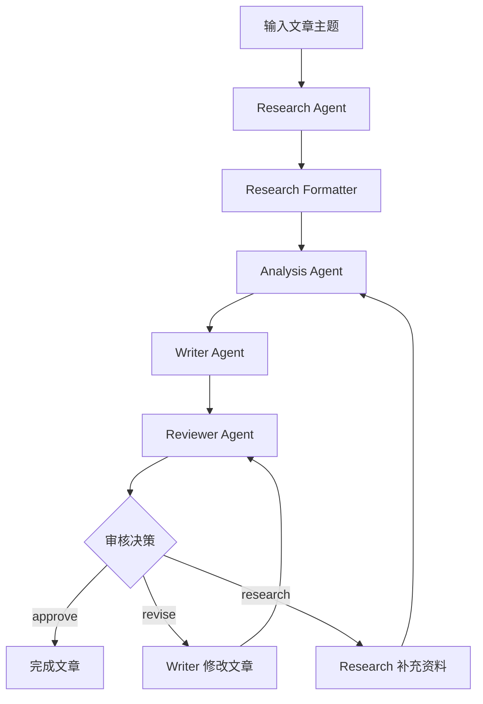

# 从零构建 Mastra 多 Agent 写作系统：Research、Analysis、Writer 与 Reviewer 协作实战

在前两篇文章中，我分别使用 Mastra 实现了 RAG 知识库和 Agent Memory。

- [从零构建 Mastra RAG MVP：DeepSeek、SiliconFlow 与 PostgreSQL/pgvector 实战](https://blog.damingerdai.com/2026/10/18/ai/mastra/mastra-rag-mvp-deepseek-siliconflow-pgvector/)
- [从 RAG 到有记忆的 Agent：Mastra Memory 与 PostgreSQL 实战](https://blog.damingerdai.com/2026/10/19/ai/mastra/mastra-memory-postgresql-practice/)

RAG 解决的是 Agent 如何获取外部知识，Memory 解决的是 Agent 如何保存和使用上下文。

那么接下来的问题是：**如果一项任务需要研究、分析、执行和审核，能不能让多个 Agent 分工协作？**

为了回答这个问题，我决定使用 Mastra 构建一个技术文章生成系统。

输入一个主题，例如：

> Go 后端为什么应该从 MD5 迁移到 Argon2id？

系统需要自动完成资料检索、技术分析、文章编写和质量审核。如果 Reviewer 认为文章存在问题，Writer 应该根据反馈修改文章，而不是简单地重新生成一遍。

这次实验的目标不是构建一个完整的内容生产平台，而是理解 Mastra 多 Agent 协作的基本原理，以及实际开发中会遇到哪些工程问题。

## 一、系统架构

我将文章生成过程拆分为四个业务 Agent。

| Agent | 职责 | 输出 |
|---|---|---|
| Research Agent | 检索知识库，收集资料 | ResearchResult |
| Analysis Agent | 分析资料，设计文章结构 | AnalysisResult |
| Writer Agent | 生成文章，处理修订意见 | DraftResult |
| Reviewer Agent | 审核文章，决定下一步操作 | ReviewResult |

整体执行过程如下：



其中，Research Formatter 是一个辅助格式化环节：Research Agent 可以先使用工具生成研究报告，再由 Formatter 将报告转换为符合 Zod Schema 的 JSON。

系统的关键不在于 Agent 数量，而在于 **每个 Agent 的输入、输出和决策边界是否清晰**。

尤其是 Reviewer，它不应该只是返回一个评分，而应该决定下一步执行什么操作。

## 二、使用 Zod 定义 Agent 之间的数据契约

多 Agent 协作首先需要解决数据交换问题。

如果 Research Agent 输出一大段自然语言，Analysis Agent 再自行理解，Writer Agent 又重新解释一次，那么信息就可能在不同 Agent 之间逐渐丢失或发生偏差。

因此，我决定使用 Zod 为各个阶段定义明确的数据结构。

### 2.1 ResearchResult

Research Agent 的任务不是写文章，而是提供事实、来源和证据缺口。

```typescript
import { z } from "zod";

export const researchSchema = z.object({
  topic: z.string(),
  findings: z.array(
    z.object({
      claim: z.string(),
      sourceId: z.string(),
      confidence: z.enum(["high", "medium", "low"]),
    }),
  ),
  sources: z.array(
    z.object({
      id: z.string(),
      title: z.string(),
      url: z.string().nullable(),
      verified: z.boolean(),
    }),
  ),
  gaps: z.array(z.string()),
  summary: z.string(),
});
```

这里有几个值得注意的字段。

`sourceId` 用于建立事实与资料来源之间的关系。`confidence` 表示研究结果的置信程度，但它并不等于事实已经得到独立验证。`verified` 用于记录来源是否已经实际检索和阅读。`gaps` 则记录当前资料中尚未解决的问题。

我不希望 Agent 在证据不足时自行补充事实，因此将证据缺口作为 ResearchResult 的一部分。

### 2.2 AnalysisResult

Analysis Agent 接收 ResearchResult，并将研究结果组织成文章结构。

```typescript
export const analysisSchema = z.object({
  topic: z.string(),
  keyPoints: z.array(
    z.object({
      point: z.string(),
      sourceIds: z.array(z.string()),
      importance: z.enum(["high", "medium", "low"]),
    }),
  ),
  outline: z.array(
    z.object({
      heading: z.string(),
      description: z.string(),
      sourceIds: z.array(z.string()),
    }),
  ),
  risks: z.array(
    z.object({
      description: z.string(),
      sourceIds: z.array(z.string()),
    }),
  ),
  missingEvidence: z.array(z.string()),
  needsMoreResearch: z.boolean(),
  summary: z.string(),
});
```

与普通文章大纲不同，这里的每个关键论点和章节都可以关联来源 ID。这让 Writer 有机会判断某个结论是否具备研究依据，而不是仅根据模型已有知识生成内容。

### 2.3 DraftResult

Writer Agent 负责将研究结果和文章大纲转换为 Markdown。

```typescript
export const draftSchema = z.object({
  title: z.string(),
  description: z.string(),
  tags: z.array(z.string()),
  categories: z.array(z.string()),
  content: z.string(),
  usedSourceIds: z.array(z.string()),
  notes: z.array(z.string()),
});
```

`content` 保存 Markdown 正文。`usedSourceIds` 保存文章实际引用的来源 ID。`notes` 用于记录需要 Reviewer 关注的编辑说明，例如证据限制、缺少性能数据等。

这里有一个重要原则：**Writer 可以组织和解释已有证据，但不应该为了让文章更完整而编造证据。**

### 2.4 ReviewResult

Reviewer 的输出决定 Workflow 的下一步执行路径。

```typescript
import { z } from "zod";

export const reviewIssueSchema = z.object({
  severity: z.enum(["high", "medium", "low"]),
  description: z.string(),
  suggestedFix: z.string(),
});

export const reviewSchema = z.object({
  decision: z.enum(["approve", "revise", "research"]),
  score: z.number().min(0).max(100).nullable(),
  issues: z.array(reviewIssueSchema),
  feedback: z.string(),
});
```

这里最重要的字段是 `decision`：`approve` 表示文章通过审核；`revise` 表示可以利用已有资料修改文章；`research` 表示缺少必要证据，需要补充研究。

为了避免不合理的审核结果，我还使用 `superRefine()` 增加业务规则：

```typescript
export const validatedReviewSchema = reviewSchema.superRefine(
  (review, ctx) => {
    if (review.decision !== "approve" && review.issues.length === 0) {
      ctx.addIssue({
        code: "custom",
        path: ["issues"],
        message: "revise/research decisions must include actionable issues",
      });
    }
    if (
      review.decision === "approve" &&
      review.issues.some((issue) => issue.severity === "high")
    ) {
      ctx.addIssue({
        code: "custom",
        path: ["decision"],
        message: "Cannot approve a draft with high-severity issues",
      });
    }
  },
);
```

需要注意的是，传给 LLM 的是基础 `reviewSchema`，而业务校验使用 `validatedReviewSchema`。这样可以把 JSON 结构约束与业务规则分开处理。

## 三、Research Agent：让知识库成为研究资料来源

Research Agent 使用之前 RAG 项目中的知识检索工具。

```typescript
import { Agent } from "@mastra/core/agent";
import { knowledgeSearchTool } from "../tools/knowledge-search.tool.js";
import { workflowModel } from "../lib/openai.js";

export const researchAgent = new Agent({
  id: "research-agent",
  name: "Research Agent",
  model: workflowModel,
  tools: { knowledgeSearchTool },
  instructions: `
You are a technical research specialist.

Responsibilities:
1. Search the knowledge base for relevant information.
2. Extract factual findings.
3. Record source references.
4. Identify missing evidence.

Rules:
- Always search before answering.
- Never invent sources.
- Clearly distinguish facts and assumptions.
- If evidence is insufficient, say so.
- Do not write the final article.

Respond in Chinese.
`,
});
```

检索工具调用之前实现的 `searchKnowledge()`：

```typescript
const results = await searchKnowledge(query, { topK: 5 });
```

其底层仍然是之前实现的 PostgreSQL/pgvector 检索方案。

这里我遇到的第一个设计问题是：Research Agent 不仅需要调用工具，还需要返回结构化数据。

最初我尝试让它直接完成这两件事情，但在模型兼容性和输出稳定性方面遇到了问题。最后采用了一个更容易调试的方式：将研究与格式化分开。

```typescript
export async function conductResearch(prompt: string) {
  const report = await researchAgent.generate(prompt, { maxSteps: 8 });

  if (!report.text.trim()) {
    throw new Error("Research returned an empty report");
  }

  const formatted = await researchFormatterAgent.generate(
    `Convert the research report into JSON.\n\nResearch report:\n${report.text}`,
    { structuredOutput: { schema: researchSchema } },
  );

  return researchSchema.parse(formatted.object);
}
```

以上省略了实际项目中的完整格式要求和来源一致性校验。

这样设计并不代表必须为每个格式化任务创建一个独立 Agent。它只是我在这个 POC 中选择的一种实现方式。如果以后需要降低成本，也可以考虑直接使用一次普通的结构化模型调用。

## 四、使用 Mastra Workflow 编排多个 Agent

单独调用四个 Agent 并不复杂。真正复杂的是：**如何让 Reviewer 的输出决定后续流程，并让 Writer 使用上一轮审核结果继续修改文章？**

我使用 Mastra 的 `createWorkflow()` 和 `createStep()` 实现这个过程。

### 4.1 初始化阶段

初始化阶段依次执行：

```typescript
const initializeStep = createStep({
  id: "initialize-article",
  inputSchema,
  outputSchema: stateSchema,
  execute: async ({ inputData }) => {
    const { topic } = inputData;

    console.log("[Research] Starting...");
    const research = await conductResearch(`Research this topic: ${topic}`);

    console.log("[Analysis] Starting...");
    const analysisResponse = await analysisAgent.generate(
      `Analyze this research:\n${JSON.stringify(research)}`,
      { structuredOutput: { schema: analysisSchema } },
    );
    const analysis = analysisSchema.parse(analysisResponse.object);

    console.log("[Writer] Creating initial draft...");
    const writerResponse = await writerAgent.generate(
      `Write an article using:\n\nResearch:\n${JSON.stringify(research)}\n\nAnalysis:\n${JSON.stringify(analysis)}`,
      { structuredOutput: { schema: draftSchema } },
    );
    const draft = draftSchema.parse(writerResponse.object);
    validateCitations(research, draft);

    return {
      topic,
      research,
      analysis,
      draft,
      reviewHistory: [],
      reviewCount: 0,
      researchRounds: 0,
      maxReviews: inputData.maxReviews,
      maxResearchRounds: inputData.maxResearchRounds,
      status: "pending" as const,
    };
  },
});
```

这段代码展示了核心结构，完整实现中还包含更严格的 Prompt 和错误处理。

这里的 `stateSchema` 非常重要。它保存研究结果、分析结果、当前草稿、审核历史以及循环计数器。下一轮审核需要读取的是最新草稿，而不是第一次生成的文章。

### 4.2 Reviewer 决策

审核阶段首先调用 Reviewer：

```typescript
const response = await reviewerAgent.generate(prompt, {
  structuredOutput: { schema: reviewSchema },
});
const review = validatedReviewSchema.parse(response.object);
```

然后根据审核结果决定下一步操作。

```typescript
if (review.decision === "approve") {
  return { ...base, status: "approved" as const };
}

if (nextCount >= maxReviews) {
  return { ...base, status: "max_reviews_reached" as const };
}

if (review.decision === "research") {
  // 补充研究，再次分析并重写文章
}

// revise：使用现有证据修改文章
```

`revise` 分支会将当前文章和 Reviewer 的反馈一起传给 Writer：

```typescript
const writerResponse = await writerAgent.generate(
  `Revise this Chinese engineering article.

Current DraftResult:
${JSON.stringify(draft)}

Reviewer:
${JSON.stringify(review)}

Address each issue using existing evidence.
Do not invent new source IDs or facts.
Return a complete DraftResult.`,
  { structuredOutput: { schema: draftSchema } },
);
```

这与简单的“重新生成文章”不同。Writer 能够读取上一轮文章和具体修改建议，围绕现有内容继续工作。

### 4.3 使用 dountil 实现审核循环

最后使用 `.dountil()` 将审核步骤连接起来：

```typescript
export const fullArticleWorkflow = createWorkflow({
  id: "full-article-workflow",
  inputSchema,
  outputSchema: stateSchema,
})
  .then(initializeStep)
  .dountil(
    reviewLoopStep,
    async ({ inputData }) => inputData.status !== "pending",
  )
  .then(finalizeStep)
  .commit();
```

只要状态仍然是 `pending`，Workflow 就继续执行审核步骤。如果 Reviewer 返回 `approve`，或者达到最大审核次数，就退出循环。

我还设置了 `maxResearchRounds`，避免系统无限补充资料。

这里需要强调：`research` 分支虽然已经实现，但在本文展示的成功测试中没有被触发，因此不能仅凭这次运行就认为补充研究路径已经得到完整验证。

## 五、实际开发中遇到的问题

这一部分是整个项目最花时间的地方。

一开始我认为最困难的是多 Agent 的工作流编排。实际开发后才发现，**结构化输出的稳定性反而是更大的问题。**

### 5.1 DeepSeek 返回合法 JSON，但不符合 Schema

最初使用的是 DeepSeek，通过 OpenAI Compatible API 接入 Mastra。

```typescript
import { createOpenAICompatible } from "@ai-sdk/openai-compatible";

export const deepseek = createOpenAICompatible({
  name: "deepseek",
  baseURL: "https://api.deepseek.com/v1",
  apiKey: process.env.DEEPSEEK_API_KEY!,
});
```

首先遇到的是 JSON 模式的请求限制：

```text
Prompt must contain the word 'json' in some form
to use 'response_format' of type 'json_object'.
```

这个问题相对容易解决，只需要在 Prompt 中明确要求返回 JSON。但之后出现的问题更加麻烦。

例如 Analysis Agent 应该返回：

```json
{
  "keyPoints": [
    {
      "point": "MD5 不适合密码存储",
      "sourceIds": ["S1"],
      "importance": "high"
    }
  ]
}
```

实际却可能返回：

```json
{
  "keyPoints": ["MD5 不适合密码存储"]
}
```

从 JSON 语法来看，两者都是合法的。但从 Zod Schema 来看，第二种显然不符合要求。

此外，我还遇到过：

- `risks` 返回字符串数组，而不是对象数组。
- `missingEvidence` 被替换成 `evidenceGaps`。
- 必填的 `summary` 字段缺失。
- 字段类型和嵌套对象结构不一致。

最终导致：

```text
STRUCTURED_OUTPUT_SCHEMA_VALIDATION_FAILED
```

这些问题在单个 Agent 中可能只是一次重试。但在多 Agent Workflow 中，某个阶段输出不符合 Schema，就会影响整个执行链。

为了兼容这些输出，我一度使用了大量 `z.preprocess()`，尝试将模型返回的数据转换成预期结构。

```typescript
const risksSchema = z.preprocess(
  (value) => {
    if (!Array.isArray(value)) return value;
    return value.map((item) => {
      if (typeof item === "string") {
        return { description: item, sourceIds: [] };
      }
      return item;
    });
  },
  z.array(riskSchema),
);
```

这种方式可以处理部分格式差异，但也会带来额外复杂度。

我逐渐意识到：如果需要编写大量代码来修正 LLM 的输出格式，那么模型与任务之间可能并不匹配。

### 5.2 切换 GPT-4.1 mini

为了提高结构化输出的稳定性，我最终将四个业务 Agent 切换到 GPT-4.1 mini。

项目使用了自定义 OpenAI 兼容 API 地址：

```typescript
import type { MastraModelConfig } from "@mastra/core/llm";

export const workflowModel: MastraModelConfig = {
  id: "bianxie/gpt-4.1-mini",
  url: "https://api.bianxie.ai/v1",
  apiKey: process.env.OPENAI_API_KEY!,
  api: "chat",
};
```

这里使用的是第三方 OpenAI 兼容代理，而不是直接连接 OpenAI 官方 API。实际部署时需要自行评估代理服务的可靠性、隐私和兼容性。

切换过程中还遇到了 AI SDK 与 Mastra 的类型兼容问题：

```text
Type 'LanguageModelV4' is not assignable to
type 'MastraLanguageModelV4'.
```

原因是直接创建的 AI SDK 模型对象与当前 Mastra 所接受的模型接口存在类型差异。最终使用 Mastra 支持的模型配置对象，避免直接传入不兼容的模型实例。

### 5.3 OpenAI Strict JSON Schema 不接受 optional 字段

切换模型后，前三个 Agent 已经可以正常执行。但 Reviewer 又遇到了一个新的问题：

```text
Invalid schema for response_format 'response':
'required' is required to be supplied
and to be an array including every key
in properties. Missing 'score'.
```

当时的 Schema 是：

```typescript
score: z.number().min(0).max(100).optional(),
```

普通 Zod 校验允许字段不存在。但 OpenAI Strict Structured Outputs 要求对象的所有属性都出现在 `required` 中。

解决方法是将 `optional()` 改成 `nullable()`：

```typescript
score: z.number().min(0).max(100).nullable(),
```

这样 `score` 仍然必须返回，但允许其值为 `null`。

这次问题让我更加明确：**Zod Schema 能够通过 TypeScript 类型检查，并不代表它一定能够直接作为 LLM 的 Strict JSON Schema 使用。**

因此，我将结构化输出 Schema 与业务规则校验分离，避免把所有约束都塞进模型输出阶段。

### 5.4 引用校验也会导致 Workflow 失败

另一个问题出现在 Writer 生成文章之后。当时的错误是：

```text
Declared but unused source: S1
```

Writer 声明使用了 `S1`，但校验程序没有在正文中识别出对应引用。最初的实现只支持 `[S1]` 这种格式。然而，模型可能生成 `[S1, S2]`、`（S1）` 等不同形式。

因此，我调整了引用提取逻辑：

```typescript
const citationGroups = [
  ...draft.content.matchAll(
    /[\[（(]((?:S\d+)(?:\s*[,，、;；]\s*S\d+)*)[\]）)]/g,
  ),
];

const cited = new Set(
  citationGroups.flatMap((match) => match[1].match(/S\d+/g) ?? []),
);
```

随后检查：声明的来源是否存在于 ResearchResult；正文引用的来源是否存在；正文引用是否包含在 `usedSourceIds` 中。

对于声明但未使用的来源，POC 阶段只输出警告，而不是直接终止 Workflow。

需要注意，这种校验只能保证引用 ID 的基本一致性。它无法证明某个技术结论真的受到对应来源支持，更无法保证来源本身真实可靠。这仍然需要更深入的证据验证。

## 六、最终运行结果

完成上述调整后，我再次运行完整 Workflow：

```bash
npx tsx src/scripts/test-full-article-workflow.ts \
  "Go 后端为什么应该从 MD5 迁移到 Argon2id？"
```

这次终于成功。

```text
[Research] Starting...
[Analysis] Starting...
[Writer] Creating initial draft...

[Citation] Validation passed
{ declared: [ 'S1' ], cited: [ 'S1' ] }

[Review 1/3] revise
[Writer] Revising from feedback...

[Citation] Validation passed
{ declared: [ 'S1' ], cited: [ 'S1' ] }

[Review 2/3] revise
[Writer] Revising from feedback...

[Citation] Validation passed
{ declared: [ 'S1' ], cited: [ 'S1' ] }

[Review 3/3] approve
```

最终结果：

```json
{
  "topic": "Go 后端为什么应该从 MD5 迁移到 Argon2id？",
  "status": "approved",
  "reviewCount": 3,
  "researchRounds": 0,
  "decisions": ["revise", "revise", "approve"],
  "title": "Go 后端为什么应该从 MD5 迁移到 Argon2id？"
}
```

整个过程经历了三次审核和两次自动修订。

第一次审核认为文章缺少 OWASP、IETF 等权威标准的直接引用，也缺少性能对比和迁移边界情况说明。第二次审核认为文章已经有所改进，但仍然存在证据和实施细节方面的不足。第三次审核最终返回 `approve`。

这说明 Writer 与 Reviewer 之间的自动修订机制已经能够正常运行。

但这次结果也暴露了一个问题：Reviewer 连续要求补充权威文献，却始终返回 `revise`，而不是 `research`。最终文章仍然只有一个引用来源 `S1`。

也就是说，系统虽然完成了自动审核闭环，但 Reviewer 的决策并不总是完全符合我们预先设计的职责边界。

这也是多 Agent 系统与传统确定性程序之间的一个重要区别：**Workflow 可以保证执行路径受到约束，但无法仅凭流程本身保证 LLM 的判断正确。**

## 七、关于多 Agent 系统的一些思考

完成这个 POC 后，我对多 Agent 有了更具体的认识。

### 7.1 多 Agent 不一定比单 Agent 更好

拆分 Agent 的好处是职责明确。Research 负责检索，Analysis 负责分析，Writer 负责写作，Reviewer 负责审核。

但拆分之后，也会引入额外成本：

- 更多 LLM 调用。
- 更多 Prompt 和 Schema。
- 更多中间状态。
- 更多错误处理。
- 更复杂的调试过程。
- 更高的 Token 消耗。

一个 Agent 输出格式不正确，就可能让整个 Workflow 失败。而 Reviewer 的一次 `revise`，可能又会触发 Writer 和 Reviewer 的多次调用。

因此，我认为是否需要多个 Agent，应该取决于任务是否真的存在独立的职责和决策边界，而不是 Agent 数量越多越好。

### 7.2 Workflow 比 Agent 数量更重要

在这个项目中，最有价值的部分不是定义了四个 Agent。真正有价值的是：

```text
Reviewer → revise → Writer → Reviewer
Reviewer → research → Research → Analysis → Writer
```

这些由审核结果驱动的执行路径。

Agent 负责在给定上下文中完成任务，Workflow 负责管理状态、限制循环和决定执行顺序。

我认为这种职责分离，比让一个 Agent 完全自主地决定所有执行步骤更容易理解和调试。

### 7.3 结构化输出应该作为工程约束

如果只是让 LLM 生成一篇 Markdown 文章，模型输出的格式偶尔发生变化，通常影响不大。但在多 Agent Workflow 中，输出会直接成为下一个程序步骤的输入。

因此，结构化输出不能只是 Prompt 中的一句：

> Please return JSON.

它应该包括明确的数据 Schema、模型对 Schema 的兼容能力、运行时数据校验、必要的业务规则校验，以及失败后的错误处理。

这些都是普通后端工程中非常熟悉的概念，只不过现在数据生产者变成了 LLM。

### 7.4 不要把审核通过等同于事实正确

本次实验最终返回了 `approved`。但 Reviewer 的判断仍然依赖于提供给它的研究资料和文章内容。

如果 Research 阶段只有一个来源，Reviewer 即使反复审核，也无法凭空获得更多可靠证据。

这说明多 Agent 的互相审核并不能自动消除幻觉。对于技术文章，尤其是涉及安全、性能和工程实践的内容，最终仍然需要开发者确认关键技术结论和引用来源。

## 八、总结：复杂结构化 Workflow 中，我暂时不推荐 DeepSeek

这次实验让我对模型选择有了比较明确的看法。

在之前的 RAG MVP 中，我使用 DeepSeek 完成知识问答，并没有遇到无法接受的问题。但在这次多 Agent Workflow 中，情况明显不同。

Research、Analysis、Writer 和 Reviewer 需要交换严格定义的 JSON 数据。任何一个阶段的字段缺失、类型错误或者对象结构不匹配，都可能导致整个 Workflow 中断。

我在 DeepSeek 上遇到的主要问题不是模型完全无法生成 JSON，而是：

**它能够生成合法 JSON，却不能在这次测试中稳定遵循复杂的 Zod Schema。**

为此，我花费了不少时间修改 Prompt、补充 Schema 描述，以及使用 `z.preprocess()` 兼容模型输出。这些工作并没有直接提升文章质量，而是在修复模型输出与程序接口之间的不一致。

切换到 GPT-4.1 mini 后，虽然也遇到了 Strict JSON Schema 的配置问题，但在修复 Schema 后，最终成功运行了完整的三轮审核流程。

所以，对于这次实验涉及的场景，我的建议是：

**如果使用 Mastra 构建多 Agent Workflow，并且严重依赖复杂的 Structured Output，我暂时不推荐优先选择 DeepSeek。**

这不是说 DeepSeek 不适合所有 Agent 应用。对于普通聊天、RAG 问答、内容生成，或者结构较简单的 JSON 输出，它仍然可能是一个具有成本优势的选择。

但对于多个 Agent 之间需要严格交换结构化数据的系统，我会优先考虑经过实际测试、能够稳定遵循 Schema 的模型。

因为模型调用成本不只有 API Token 费用，还包括重试、错误处理、调试和维护成本。一个 Token 单价更低的模型，如果经常导致工作流中断，最终未必更便宜。

至于这个 POC，我决定到这里为止。不继续增加 Agent，也不准备把它扩展成一个复杂的自动化内容生产平台。

通过这次实验，我已经验证了 Mastra 多 Agent 协作中最想理解的几个问题：结构化数据如何传递、Workflow 如何管理状态、Reviewer 如何驱动修订，以及模型不稳定时会给整个系统带来什么影响。

对我来说，这些收获已经足够。

**多 Agent 的目标不应该是让系统拥有更多 Agent，而应该是让复杂任务变得更可靠、更容易控制。**
