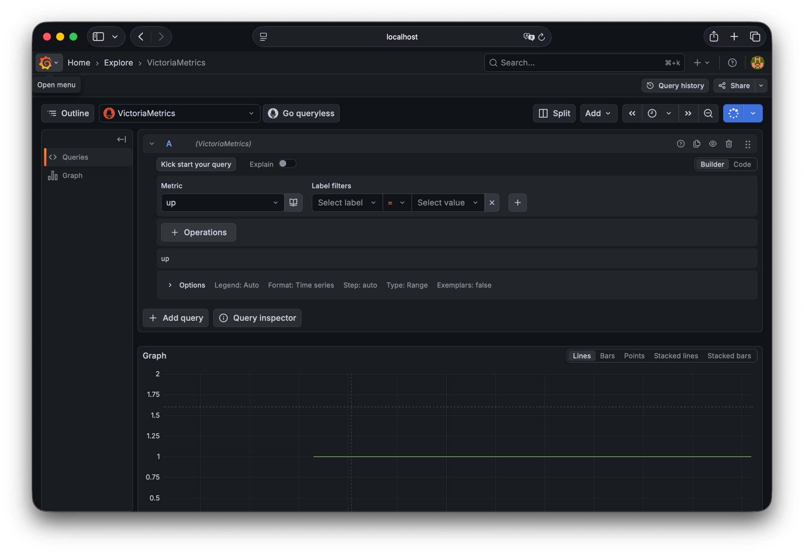
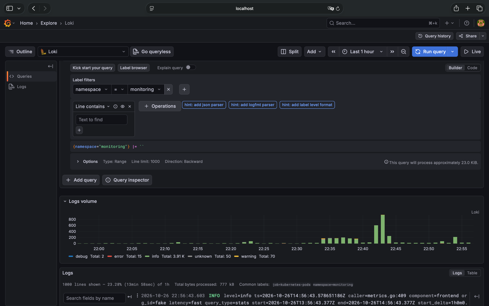

# 4GB 内存跑 Kubernetes 可观测性：K3s + FluxCD + VictoriaMetrics + Loki + Grafana Alloy 实战

## 前言

最近整理自己的 K3s Homelab，希望给 Kubernetes 上的业务应用补齐 Metrics 和 Logs 两条可观测性链路。我的机器资源有限：单节点 K3s、约 4GB 内存、4 核 CPU，系统为 Debian，部署通过 FluxCD GitOps 管理。

这次的边界很明确：**监控 K3s/Kubernetes 和其中的业务应用，不额外监控宿主机 Docker 容器或独立运行的 PostgreSQL**。指标和日志都以保留 7 天为目标，优先考虑组件数量、内存占用和可维护性。

最终采用：

- **VictoriaMetrics Single**：存储与查询 Prometheus 兼容指标。
- **Grafana Loki（SingleBinary）**：集中存储 Kubernetes Pod 日志。
- **Grafana Alloy（DaemonSet）**：负责发现、采集并转发指标与日志。
- **Grafana**：统一查询与可视化。
- **FluxCD**：通过 HelmRelease 管理版本和配置。

本文记录实际部署、遇到的故障、解决过程，以及 Grafana Explore 的验证截图。**这是一套 Homelab 实践，不代表已经完成企业级高可用、告警和容量规划。**

## 一、部署环境与架构

| 项目 | 配置 |
|---|---|
| 系统 | Debian Linux |
| Kubernetes | 单节点 K3s |
| 节点 | `daming-thinkpad-e470` |
| 节点地址 | `192.168.31.222`（局域网示例） |
| CPU / 内存 | 4 核 / 约 4GB |
| GitOps | FluxCD |
| 持久化存储 | K3s `local-path` PVC |
| 指标与日志保留 | 目标 7 天，需结合最终 Helm Values 验证 |

```text
Kubernetes Metrics ─┐
                    ├─> Grafana Alloy ──remote_write──> VictoriaMetrics ─┐
Kubernetes Pod Logs ┘                └──Loki push──────> Loki ────────────┤
                                                                          v
                                                                        Grafana
```

核心原则是**采集、存储和展示分离**。Alloy 负责收集和转发，VictoriaMetrics/Loki 分别存储指标与日志，Grafana 负责查询和展示。

## 二、为什么选这套组合

对于单节点 4GB 内存的机器，我不希望部署过多重量级组件。VictoriaMetrics Single 提供 Prometheus 兼容的查询接口，也能接收 Remote Write；Loki SingleBinary 避免了分布式日志系统的额外组件；Alloy 同时承担指标与日志采集，便于统一管理。

这不意味着 Prometheus 或 Elasticsearch 不能运行，而是当前机器和目标更适合这套组合。Grafana 仍然可以把 VictoriaMetrics 配置为 **Prometheus 类型**的数据源，Loki 则配置为 **Loki 类型**。

## 三、使用 FluxCD 管理部署

这次使用的 Helm Chart 版本：

| 组件 | Chart 版本 |
|---|---|
| Alloy | `1.14.3` |
| Grafana | `10.5.15` |
| Loki | `7.5.0` |
| VictoriaMetrics Single | `0.49.0` |

GitOps 目录按组件拆分：

```text
clusters/
└── 192.168.31.222/
    └── monitoring/
        ├── alloy/
        ├── grafana/
        ├── loki/
        └── victoria-metrics/
```

检查状态：

```bash
flux get helmreleases -n monitoring
kubectl get pods -n monitoring
kubectl get pvc -n monitoring
```

所有资源的真实配置应以仓库中的 HelmRelease 为准。下文展示的是**实际排障时使用过的关键配置片段**，并非可以直接部署的完整 HelmRelease 清单。

## 四、踩坑一：VictoriaMetrics 参数单位

最初设置了：

```yaml
memory.allowedBytes: "128Mi"
```

启动失败。这里的参数需要字节数量，改成：

```yaml
memory.allowedBytes: "134217728"
```

即 128 × 1024 × 1024 字节。**不要假设 Helm Values 的每个参数都能使用 Kubernetes `Mi`、`Gi` 资源单位**：最终要看参数由哪个程序解析。

## 五、踩坑二：Alloy 初始化耗时与 Readiness

最初给 Alloy 设置了比较紧的限制：CPU `200m`、内存 `128Mi`，Readiness 超时也较短。运行时 River Graph Evaluation 非常慢，Pod 长时间无法 Ready。

后来将相关 Values 调整为：

```yaml
alloy:
  timeoutSeconds: 5
  resources:
    requests:
      cpu: 50m
      memory: 64Mi
    limits:
      cpu: 500m
      memory: 256Mi
```

调整后 Alloy 的配置图评估时间显著下降，Readiness Endpoint 返回 HTTP 200，Pod 进入 `2/2 Running`。

注意不要把几种现象混为一谈：**CPU throttling**、Kubernetes API 的 **client-side throttling**、River Graph Evaluation 耗时、Readiness Probe 超时是不同概念。此次资源调整改善了实际表现，但并不等于单凭这些现象就能证明全部根因。

## 六、踩坑三：Grafana `init-chown-data` 权限错误

Grafana 使用 `local-path` PVC 保存数据。更新过程中，初始化容器报错：

```text
chown: /var/lib/grafana/csv: Permission denied
chown: /var/lib/grafana/png: Permission denied
chown: /var/lib/grafana/pdf: Permission denied
```

Pod 因而进入 `Init:Error`。排查时需要同时检查 PVC 宿主机路径、目录所有权、运行用户、Pod SecurityContext 和初始化容器权限。

Grafana 通常以 UID 472 运行。可以考虑在确认目录可写后关闭初始化 chown：

```yaml
initChownData:
  enabled: false
```

但这**不是通用权限修复**：如果 Grafana 主进程本身无权写入 PVC，跳过初始化容器只会把错误推迟到应用启动时。对于没有重要数据的新环境，重新创建 Grafana PVC 也是可选方案，但会丢失其中数据。不要为了修复 Grafana 而删除 Loki 或 VictoriaMetrics 的 PVC。

## 七、踩坑四：RollingUpdate 切换 Recreate 的字段冲突

单副本 Grafana 使用 PVC 和本地 SQLite 数据库时，我希望避免滚动更新期间新旧 Pod 同时访问同一目录，因此将 Deployment 策略改为：

```yaml
deploymentStrategy:
  type: Recreate
```

FluxCD 随后报错：

```text
Deployment.apps "grafana" is invalid:
spec.strategy.rollingUpdate: Forbidden:
may not be specified when strategy `type` is 'Recreate'
```

原因是已有 Deployment 保留了 `rollingUpdate` 字段。Kubernetes 不允许 `Recreate` 与 `rollingUpdate` 配置同时存在。

这次通过一次性 JSON Patch 清除旧字段并修改策略：

```bash
kubectl patch deployment grafana \
  -n monitoring \
  --type=json \
  -p='[
    {"op":"remove","path":"/spec/strategy/rollingUpdate"},
    {"op":"replace","path":"/spec/strategy/type","value":"Recreate"}
  ]'
```

然后恢复 FluxCD 协调：

```bash
flux reconcile helmrelease grafana -n monitoring --reset
```

注意：`kubectl patch` 是一次性的故障修复，**长期期望状态仍应保存在 GitOps HelmRelease 中**。同时，`Recreate` 只是避免重叠运行的更新策略，不是 PVC 权限问题的直接修复。

## 八、最终运行状态与资源开销

恢复后：

```text
alloy-26ll2                                         2/2 Running
 grafana-769c4cc54c-cv8tj                           1/1 Running
 loki-0                                              2/2 Running
 victoria-metrics-victoria-metrics-single-server-0   1/1 Running
```

> 上面是一次运行状态快照；Grafana 当时有一次历史重启。Pod Ready 不代表 FluxCD 的所有 HelmRelease 一定都是 Ready，仍需单独检查。

执行：

```bash
kubectl top pods -n monitoring --sort-by=cpu
kubectl top node
```

当时的结果：

| 组件 | CPU | 内存 |
|---|---:|---:|
| Grafana | 77m | 92Mi |
| Loki | 21m | 164Mi |
| Alloy | 10m | 152Mi |
| VictoriaMetrics | 5m | 41Mi |
| **四组件合计** | **113m** | **449Mi** |

节点整体：CPU `883m`（22%），内存 `2121Mi`（55%）。这只是**一个时间点的实际使用量**，不是 requests/limits，也不是长期峰值。节点整体开销还包含 K3s、其他工作负载和系统进程。

## 九、验证 Grafana API 与数据源

先通过 Port Forward 访问 Grafana：

```bash
kubectl port-forward -n monitoring svc/grafana 3000:80
```

另一个终端检查：

```bash
curl -i --max-time 10 http://localhost:3000/api/health
```

返回 HTTP `200 OK`，正文包括：

```json
{
  "database": "ok",
  "version": "12.3.1",
  "commit": "3a1c80ca7ce612f309fdc99338dd3c5e486339be"
}
```

### 9.1 VictoriaMetrics：PromQL `up`

Grafana → Explore → VictoriaMetrics 数据源，执行：

```promql
up
```



*图 1：VictoriaMetrics 数据源中 `up` 指标返回值为 1 的时间序列。*

这证明至少有一个采集目标成功被抓取，并且查询链路工作正常。**仅凭 `up=1` 不能说明所有 Kubernetes 节点、Pod 或业务应用指标都已覆盖**；还应查看具体的 `job`、`instance` 标签及业务指标。

### 9.2 Loki：查询 Kubernetes 日志

Grafana → Explore → Loki 数据源，执行：

```logql
{namespace="monitoring"}
```



*图 2：Loki 返回 monitoring 命名空间的日志，Grafana 同时显示日志量分布。*

可以看到最近一小时的日志量图和具体日志行。继续排查时可尝试：

```logql
{namespace="monitoring"} |= "error"
```

这是字符串包含过滤；是否能准确匹配应用错误等级，取决于日志格式。更精细的过滤应使用实际存在的标签或解析后的字段。

### 9.3 两条链路的验证边界

| 项目 | 结果 | 说明 |
|---|---|---|
| Grafana API | HTTP 200 | 服务可访问 |
| Grafana 数据库 | `ok` | 数据库健康检查通过 |
| VictoriaMetrics | `up=1` | 至少一个抓取目标成功 |
| Loki | 返回 Pod 日志 | 日志查询链路可用 |
| Namespace 标签 | `monitoring` 可筛选 | Kubernetes 元数据已用于日志查询 |

这些结果说明基本的 Metrics 和 Logs 查询链路已经打通；后续仍需验证应用指标覆盖率、7 天保留策略和高负载稳定性。

## 十、后续计划

1. 增加 Kubernetes Dashboard：Node、Pod、Namespace 的 CPU、内存、重启和运行状态。
2. 为 Go、Spring Boot 等业务应用暴露 HTTP 请求、错误率和延迟指标，并验证 Alloy 采集。
3. 优化 Loki 日志标签与结构化日志格式，避免高基数标签。
4. 观察 24 小时及更长时间的资源峰值，再调整 requests/limits。
5. 核对 VictoriaMetrics 与 Loki 的最终 Helm Values，验证指标和日志的 7 天保留确实生效。
6. 持续检查 FluxCD HelmRelease 状态，避免出现 Pod Running 但 GitOps 升级失败的情况。

## 总结

这次最大的收获不是安装了 Grafana，而是把 **Kubernetes 日志与指标的采集、存储和查询**串成了一条可验证的链路，并在单节点、约 4GB 内存的约束下跑通。

过程中遇到的 VictoriaMetrics 参数单位、Alloy 启动与 Readiness、Grafana PVC 权限、Deployment 更新策略冲突，都提醒我：**可观测性平台本身也需要可观测、可排障、可恢复。**

对于 Homelab，先把基础 Metrics 和 Logs 跑通，再逐步增加 Dashboard、应用指标和告警，比一开始堆齐全部组件更实用。
